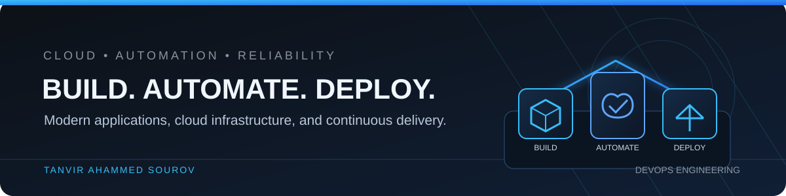

<!--
  GitHub Profile README for @tsourov211-eng
  Keep the descriptions and learning areas updated as projects progress.
-->

# Hi, I'm Tanvir Ahammed Sourov 👋

### Aspiring DevOps Engineer | Cloud & Automation | Web Development

I build modern web applications and am developing practical skills in deploying, automating, and operating them with cloud and DevOps practices.

---

## About Me

- 🚀 Focused on building a career in **DevOps Engineering and Cloud Infrastructure**.
- 🧩 Build web applications with **HTML, Tailwind CSS, React, Next.js, Node.js, and TypeScript**.
- ☁️ Developing practical knowledge of cloud infrastructure, Linux, networking, and deployment workflows.
- ⚙️ Interested in automating repeatable software delivery through CI/CD and container-based workflows.
- 📍 Dhaka, Bangladesh.

## Technology Stack

### Web Development

### DevOps & Cloud — Learning and Practicing

## Featured Projects

| Project | Overview |
|---|---|
| [**ShopBondhu AWS Cloud Assignment**](https://github.com/tsourov211-eng/hopbondhu-aws-assignment) | Practical AWS networking assignment covering a VPC, public and private subnets, an Internet Gateway, NAT Gateway configuration, EC2, and Nginx. The repository README records remaining verification and setup tasks. |
| [**DevOps Module 1 Assignment**](https://github.com/tsourov211-eng/DevOps-Module-1-Assignment-01) | DevOps fundamentals, SDLC, networking, scenario-based questions, and practical deployment exercises. |
| [**Mess Management System**](https://github.com/tsourov211-eng/Mess-management-system-version-0.2) | Full-stack application with Next.js, role-based workspaces, meal and expense management, authentication, and reporting. |
| [**Brother’s Tiles & Sanitary Mart**](https://github.com/tsourov211-eng/brothers-tiles-sanitary-mart-v01) | Business website built with Next.js, React, TypeScript, and Tailwind CSS. |
| [**Python 90-Day Roadmap**](https://github.com/tsourov211-eng/python-90-day-roadmap) | Public repository for a structured Python learning journey. |

## Current Learning Focus

- Linux administration, command-line workflows, and Bash scripting.
- AWS core services, VPC networking, EC2, and IAM fundamentals.
- Git and GitHub collaboration workflows.
- CI/CD concepts and GitHub Actions automation.
- Docker fundamentals and containerized application deployment.

## GitHub Activity

---

### Let's Connect

Open to learning, collaboration, and entry-level opportunities in DevOps and Cloud Engineering.

