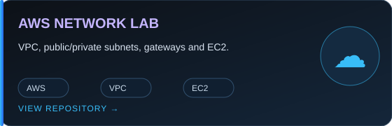
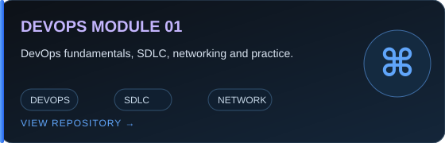
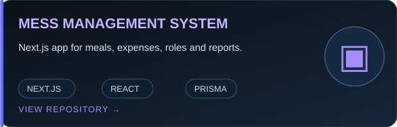
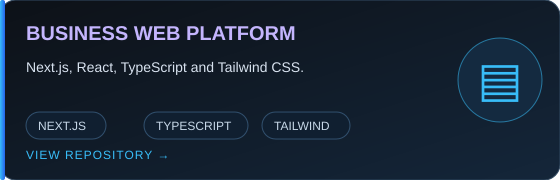

<!-- Profile README for @tsourov211-eng -->

  
  <h1>Tanvir Ahammed Sourov</h1>
  <h3>Aspiring DevOps Engineer · Cloud & Automation · Web Development</h3>
  
Building web applications and learning to deploy, automate, and operate them using cloud infrastructure and DevOps practices.

  
  

---

## Profile

<table>
  <tr>
    <td width="50%">
      <h3>What I Build</h3>
      <ul>
        <li>Web applications with React, Next.js, Node.js, and TypeScript.</li>
        <li>Responsive interfaces with HTML and Tailwind CSS.</li>
        <li>Practical cloud labs and application deployment exercises.</li>
      </ul>
    </td>
    <td width="50%">
      <h3>Where I'm Growing</h3>
      <ul>
        <li>Linux, networking, and AWS fundamentals.</li>
        <li>Git workflows and CI/CD automation.</li>
        <li>Docker and repeatable deployment workflows.</li>
      </ul>
    </td>
  </tr>
</table>

## Technology Stack

  

## Featured Projects

<table>
  <tr>
    <td width="50%" valign="top">
      
      
<b><a href="https://github.com/tsourov211-eng/hopbondhu-aws-assignment">ShopBondhu AWS Cloud Assignment</a></b> AWS VPC, public/private subnets, Internet Gateway, NAT Gateway configuration, EC2, and Nginx. The repository documents outstanding verification steps.

    </td>
    <td width="50%" valign="top">
      
      
<b><a href="https://github.com/tsourov211-eng/DevOps-Module-1-Assignment-01">DevOps Module 1 Assignment</a></b> DevOps fundamentals, SDLC, networking, scenario-based questions, and practical deployment exercises.

    </td>
  </tr>
  <tr>
    <td width="50%" valign="top">
      
      
<b><a href="https://github.com/tsourov211-eng/Mess-management-system-version-0.2">Mess Management System</a></b> Next.js application with role-based workspaces, meal and expense management, authentication, and reporting.

    </td>
    <td width="50%" valign="top">
      
      
<b><a href="https://github.com/tsourov211-eng/brothers-tiles-sanitary-mart-v01">Brother’s Tiles &amp; Sanitary Mart</a></b> Business website built with Next.js, React, TypeScript, and Tailwind CSS.

    </td>
  </tr>
</table>

## Current Learning Focus

<table>
  <tr><td>01</td><td><b>Linux & Networking</b> Command-line workflows, permissions, services, IP addressing, and troubleshooting.</td></tr>
  <tr><td>02</td><td><b>AWS & Cloud</b> VPC, EC2, IAM, gateways, and secure cloud network fundamentals.</td></tr>
  <tr><td>03</td><td><b>CI/CD & Automation</b> Git workflows, GitHub Actions, build and deployment pipelines.</td></tr>
  <tr><td>04</td><td><b>Containers</b> Docker fundamentals and containerized application workflows.</td></tr>
</table>

## GitHub Activity

  
  
  

---

  <h3>Let's Connect</h3>
  
Interested in DevOps, cloud engineering, web development, and collaborative learning.

  
  

